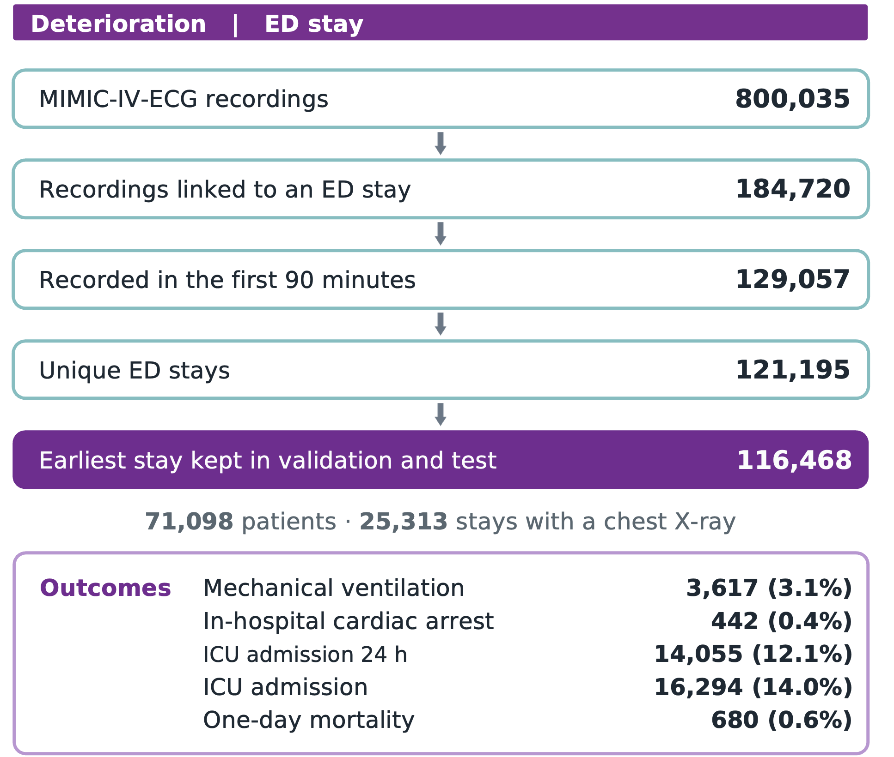
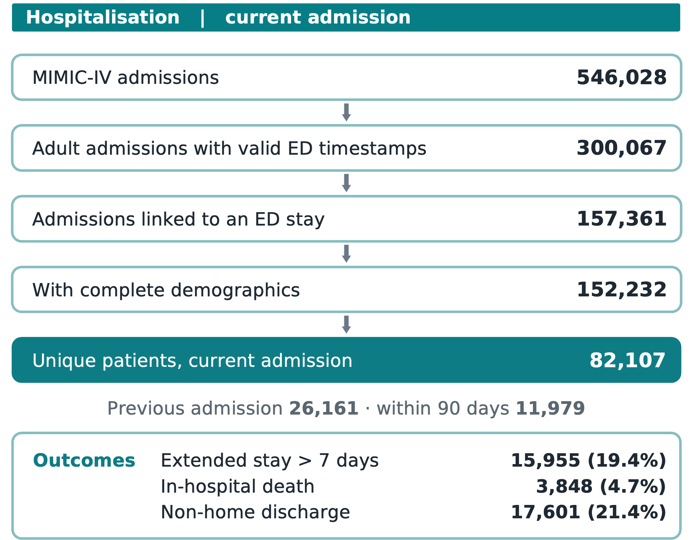
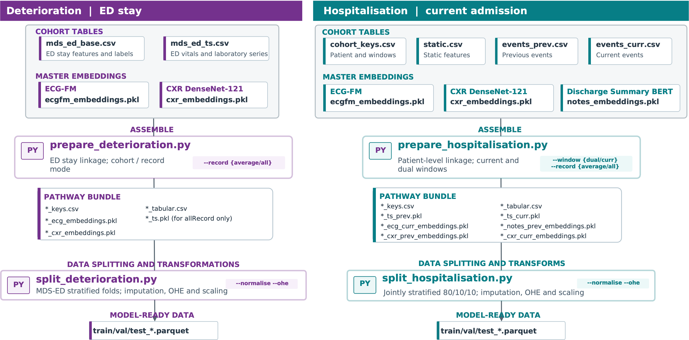
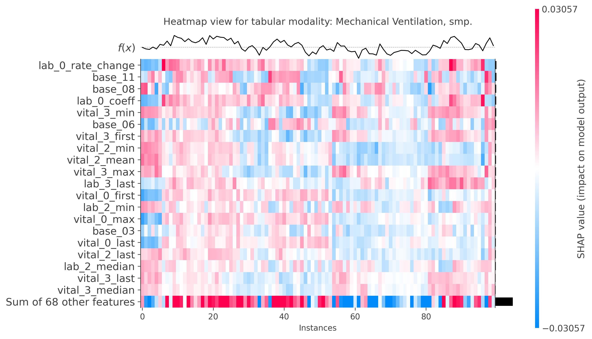
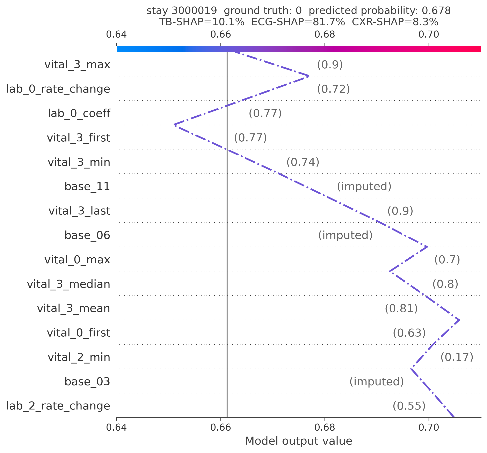

# API reference

This page describes the command-line interfaces, configurations and outputs used by the
pipeline. Run scripts from the repository root. Use `--help` on any command for its full help.
For runnable workflows, see the [examples](examples/deterioration.md).

## Cohort building

The two cohort builders use hard-coded MIMIC source paths. The sections below describe
the input tables, cohort definitions, arguments and outputs for the
[deterioration](#deterioration-cohort) and [hospitalisation](#hospitalisation-cohort) cohorts.

### Deterioration cohort

`src.preprocessing.build_deterioration` constructs the ECG-linked ED cohort, derives outcome
labels and writes tabular EHR features, vital signs and laboratory measurements from the first
90 minutes after ED arrival.
It reads source tables and ECG metadata, not waveform or image embeddings. Embedding extraction,
[bundle preparation and splitting](#deterioration-preparation-and-splitting) are
separate steps.

#### Inputs

Source paths sit beneath `../data/MIMIC-IV`. Filenames and compression must match the paths in
the script:

| Source directory under `../data/MIMIC-IV` | Required files |
|---|---|
| `mimiciv/3.1/hosp/` | `admissions.csv`, `diagnoses_icd.csv`, `omr.csv`, `d_labitems.csv`, `labevents.csv`, `procedures_icd.csv.gz` |
| `mimiciv/3.1/icu/` | `icustays.csv` |
| `mimic-iv-ed/2.2/ed/` | `edstays.csv.gz`, `pyxis.csv.gz`, `diagnosis.csv.gz`, `triage.csv.gz`, `vitalsign.csv` |
| `mimic-iv-ecg-ext-icd-diagnostic-labels-for-mimic-iv-ecg-1.0.1/` | `records_w_diag_icd10.csv` |

Outputs are written under `../outputs/mds_ed`. There are no input-root or output-directory
CLI options. Running on another layout requires changing the corresponding source constants.

#### Cohort definition

- Start from the linked ECG metadata and retain recordings matched to an ED stay within the
  inclusive window from ED arrival to 90 minutes after arrival.
- Exclude records with no linked diagnostic codes. The source population and its age coverage
  are inherited from the linked MIMIC records. The builder adds no explicit adult-age filter.
- Retain the source `strat_fold` assignment rather than generating a new partition. Splitting
  later uses this assignment to construct train, validation and test datasets.
- Require no CXR or note record and impose no minimum number of vital-sign or laboratory
  measurements.

In time-series mode, the base table keeps one row per ED stay. When several ECGs match a stay,
`--stay-pick last` selects the latest in-window ECG for the base row. `first` selects the earliest.
This affects ECG-dependent source fields, including biometrics and the stay-mortality label.
It does not select the embeddings subsequently linked by bundle preparation.

<figure markdown="1" style="max-width: 600px; margin: 1rem auto; padding: 0.5rem; background: #fff; color: #263238;">

[](assets/results_cohort_selection_deterioration.png)

<figcaption style="color: #263238;">Deterioration cohort counts from the reported evaluation. Keeping the earliest validation/test stay is a later splitting step, not a filter applied by this builder. Counts may vary with source data and cohort settings.</figcaption>

</figure>

#### Features and labels

The base table contains identifiers, observation timestamps, source folds, demographics,
biometrics, diagnosis indicators, triage acuity and `deterioration_*` labels. The measurement
table retains timestamped values for six vital signs and the 45 laboratory-test names configured
in the script. Missing cells remain available for downstream preprocessing to handle.

The builder emits 15 outcome columns across these families:

| Family | Outcomes |
|---|---|
| Acute deterioration | Severe hypoxemia, ECMO, vasopressors, inotropes, mechanical ventilation and cardiac arrest |
| ICU admission | Within 24 hours and during the hospital stay |
| Mortality | One, seven, 28, 90, 180 and 365 days, plus mortality during the stay |

Outcome definitions use the source-specific death, ICU, procedure, medication, diagnosis and
vital-sign rules. They do not all share one prediction horizon. Some undefined or excluded labels
remain `-999`, including mortality before the 90-minute cutoff and ICU labels where all contacts
precede that cutoff. Bundle preparation converts these sentinels to missing labels.

The reported comparisons use five outcomes: mechanical ventilation, cardiac arrest, one-day
mortality, ICU admission within 24 hours and ICU admission during the stay. These are a subset
of the columns available for downstream experiments.

#### Modes and commands

Run from the repository root in the project environment. 

```sh
# Main input tables for bundle preparation (default: ts mode)
python -m src.preprocessing.build_deterioration

# Optional aggregated static table
python -m src.preprocessing.build_deterioration --mode static

# Rerun measurements from a previously saved prefix checkpoint
python -m src.preprocessing.build_deterioration --mode test
```

| Option | Behaviour |
|---|---|
| `--mode {static,ts,test}` | Select outputs or reuse the prefix checkpoint. Default: `ts` |
| `--stay-pick {first,last}` | Select the ECG source row per stay in time-series output. Default: `last` |
| `--no-checkpoint` | Skip saving the shared-prefix checkpoint in `static` or `ts` mode |

`--mode test` requires an existing `prefix_checkpoint.pkl`. It skips the shared cohort-building
prefix and reruns the laboratory and time-series output stage for the saved cohort. It is not a
small-sample smoke test, does not cap the cohort and can overwrite the normal time-series outputs.

To build both static and time-series outputs sequentially, skipping time-series mode if static
mode fails:

```sh
python -m src.preprocessing.build_deterioration --mode static && \
  python -m src.preprocessing.build_deterioration --mode ts
```

#### Key outputs

| File under `../outputs/mds_ed` | Contents |
|---|---|
| `mds_ed_base.csv` | One row per ED stay, with base features and outcome labels |
| `mds_ed_ts.csv` | One row per stay and measurement time, with vital signs and laboratory measurements |
<!-- | `mds_ed_ts_keys.csv` | `ts`/`test`: stay identifiers, measurement counts and availability flags for measured stays |
| `mds_ed_static.csv` | `static`: ECG-record-level features, summarised vital signs and laboratory measurements, and outcome labels. Stays can repeat | -->

<!-- The base table uses `general_subject_id`, `general_ed_stay_id`, `general_ed_hadm_id` and
`general_strat_fold`. The time-series and key tables use `subject_id`, `ed_stay_id` and
`ed_hadm_id`. Bundle preparation normalises the base identifiers before linking these tables.
The checkpoint and cache depend on the input data, so reuse them only with matching sources. -->

#### Next steps

Extract or reuse the [ECG](#ecg-embeddings) and [CXR embeddings](#chest-x-ray-embeddings), then
[prepare and split deterioration bundles](#deterioration-preparation-and-splitting)
from `mds_ed_base.csv` and `mds_ed_ts.csv` for model training.
The [hospitalisation cohort section](#hospitalisation-cohort) covers the other pathway.

### Hospitalisation cohort

`src.preprocessing.build_hospitalisation` builds the hospitalisation cohort from MIMIC-IV hosp
3.1 and MIMIC-IV-ED 2.2. The unit of analysis is the patient, with one **current admission**
retained per patient. This is the most recent eligible hospital admission linked to an ED stay.
The script writes patient and admission identifiers, static EHR features, outcome labels and
time-series measurements for the current and legacy observation windows.

ECG, CXR and note embeddings are linked to the cohort during dataset preparation in
`prepare_hospitalisation.py`. The `--skip-events` option omits event tables and cannot produce a
complete input for bundle preparation.

#### Processing stages

The script runs eight stages, reporting progress as it moves through them:

1. Read `admissions` and `patients`, validate timestamps, keep adults only.
2. Require an `edstays` join on `hadm_id` and complete demographics, then select each patient's last
   and previous admission.
3. Write `cohort_keys.csv` and report the cohort sizes.
4. Derive static EHR features and the three current-admission outcome labels, and write
   `static.csv`.
5. Stream `labevents` once for both windows, restricted to the 50-itemid panel. This is the slow
   stage.
6. Append ED vitals for both windows.
7. Pivot each window to the wide layout and write `events_prev.csv` and `events_curr.csv`.
8. Write `extract_summary.json`.

The cohort table is saved at stage 3, before processing the laboratory measurements.

#### Basic usage

```sh
# cohort and static only, no labevents pass - seconds, for iterating on the cohort definition
python -m src.preprocessing.build_hospitalisation --skip-events

# full optionalHistory run (the default)
python -m src.preprocessing.build_hospitalisation

# full requiredHistory run
python -m src.preprocessing.build_hospitalisation --history required
```

Sources read, with no CLI override:

```text
../data/MIMIC-IV/mimiciv/3.1/hosp/     admissions, patients, labevents, d_labitems,
                                       diagnoses_icd, emar, omr, poe
../data/MIMIC-IV/mimic-iv-ed/2.2/ed/   edstays, triage, vitalsign
config/event_items.csv                 the lab panel and every plausibility bound
config/ltc_mapping.json                the long-term-condition ICD prefixes
```

Default output directory:

```text
../outputs/hospitalisation/3.1/extract
```

The `3.1` names the MIMIC-IV hosp release the tables were read from, and comes from the same setting
that points the script at its source directory, so an extract cannot be filed under a release it was
not built from.

#### Important arguments

- `--output-dir`, `-o` — parent directory for the output tables. Every table lands in the
  `requiredHistory/` or `optionalHistory/` subdirectory of it, named for `--history`, so the two
  extracts never share a directory and neither is the unlabelled default.
  Default: `../outputs/hospitalisation/3.1/extract`
- `--history` — whether a previous admission discharged within the lookback window is required
  for inclusion. `required` selects patients with a qualifying previous admission before processing
  laboratory measurements. `optional` also retains patients without one. Default: `optional`
- `--lookback-days` — maximum interval between the previous discharge and current ED arrival,
  in days. Records eligibility in `has_prev_band`. Default: `90`
- `--skip-events` — write cohort identifiers, static EHR features and outcome labels without
  processing laboratory measurements or ED vital signs.
  Default: off
- `--test-mode`, `-t` — restrict to the first 50,000 admissions. Default: off

#### The two windows

Two observation windows capture current and historical patient information:

- **Current window (`curr`):** ED arrival to the recorded hospital admission time for the current
  admission.
- **Legacy window (`prev`):** ED arrival to discharge for the next most recent eligible ED-linked
  admission, provided discharge falls within the lookback window before current ED arrival.

```text
prev      [prev_edregtime, prev_dischtime]     legacy window
curr      [edregtime, admittime)               current window
```

The implementation uses `admittime` as the end of the current window and excludes measurements
at or after that timestamp. This keeps the observation window before the admission-to-discharge
period used to define hospital length of stay.

All three outcome labels describe the current admission. The legacy window provides information
from the previous admission.

#### Cohort definition

- **ED linkage** — an `edstays` join on `hadm_id`, required on the last *and* the previous stay.
- **Complete demographics** — `anchor_age` at least 18, plus `gender`, `marital_status` and
  `insurance`, applied before last/previous selection since static is a patient-level property.
- **Lookback window** — `prev_dischtime` within 90 days of `last_edregtime`, recorded as
  `has_prev_band`.
- **Modality availability** — static EHR information is retained for every patient. Other modalities
  may be missing.

<figure markdown="1" style="max-width: 600px; margin: 1rem auto; padding: 0.5rem; background: #fff; color: #263238;">

[](assets/results_cohort_selection_hospitalisation.png)

<figcaption style="color: #263238;">Hospitalisation cohort counts from the reported evaluation, showing the optional-history cohort and the subset with a previous admission within 90 days. Counts may vary with source data and cohort settings.</figcaption>

</figure>

##### What `--history` does not change

The lookback window applies to legacy-window data under both settings. Previous admissions
discharged outside this window are excluded from the historical information used for prediction.

`--history required` retains only patients with a qualifying previous admission.
`--history optional` also retains patients without one, whose legacy-window modalities are missing.
In the reported cohort, 11,979 of 82,107 patients had a qualifying previous admission, and 11,978
had recorded time-series measurements in the legacy window.

#### Features and labels

`static.csv` contains one row per patient, with demographics, biometrics, encounter details,
previous-admission history, triage acuity, long-term conditions, medications and care orders.
Feature columns use family prefixes such as `demographics_` and `history_`. Timestamp columns
under `general_` and outcome columns under `hospitalisation_` are excluded from model features.

Three outcome labels describe the current admission:

| Label | required | optional |
| --- | --- | --- |
| `hospitalisation_ext_stay_7` | 29.72% | 19.43% |
| `hospitalisation_in_hosp_death` | 10.19% | 4.69% |
| `hospitalisation_non_home_discharge` | 30.75% | 21.44% |

Every rate is roughly twice as high in the required cohort. A recent previous admission selects for
a sicker population, so the two cohorts are not interchangeable and a model trained on one should
not have its prevalence compared against the other.

`in_hosp_death` is taken from `admissions.deathtime`, not from a `patients.dod` comparison. `dod` is
date-only, so a `dod`-based test misses every patient admitted and dying on the same calendar date,
and those rows then score 0 on all three labels — which would make the worst outcome in the cohort
invisible.

#### Key outputs

| File under `../outputs/hospitalisation/3.1/extract/<history>History/` | Contents |
|---|---|
| `cohort_keys.csv` | One row per patient, with patient and admission identifiers and observation windows |
| `static.csv` | One row per patient, with static features and outcome labels |
| `events_prev.csv` | One row per patient and measurement time, with vital signs and laboratory measurements from the legacy window |
| `events_curr.csv` | One row per patient and measurement time, with vital signs and laboratory measurements from the current window |
<!-- | `extract_summary.json` | Run settings and cohort counts | -->

`--history` selects the `requiredHistory/` or `optionalHistory/` subdirectory.
`--skip-events` omits the two event tables.

`cohort_keys.csv` is required by dataset preparation to identify patients and admissions and apply
observation windows. The identifiers are `subject_id`, `last_hadm_id` and `ed_stay_id`. The event
tables use `subject_id` and `charttime`, with one column per vital sign or laboratory marker.

#### Notes

- **`--test-mode` does not mark its output.** Unlike `prepare_hospitalisation.py`, which appends
  `_test2000` to the bundle name, the extract writes its 50,000-admission subset straight into
  `<history>History/` under whatever `--output-dir` it was given. Running it against the default
  therefore overwrites the production extract. Always pass an explicit `--output-dir` when testing.
- The `labevents` scan reads an 18.4 GB, 158-million-row table and takes roughly 25 minutes. It is
  the only expensive stage, and `--skip-events` avoids it entirely.
- Building both history configurations requires two runs because `--history required` selects
  patients before processing laboratory measurements.
- The pipeline uses `pandas` throughout, except the `labevents` scan, which uses Polars to stream a table too large to
  hold in memory.

## Modality embedding extraction

Each extractor writes a full-source embedding table, a key CSV and metadata. These outputs are
independent of the chosen cohort. Test mode processes the first 100 records and adds `_test100` to
output names. Install the prerequisites in the
[README](https://github.com/nhsengland/mm-healthfusion/blob/main/README.md#installation).

### ECG embeddings

`src.preprocessing.extract_ecg` reads `record_list.csv` and waveforms. It uses
[ECG-FM](https://arxiv.org/abs/2408.05178), resamples to 500 Hz, and pools five-second segments into
one vector per ECG. CUDA is selected when available.

| Argument | Purpose and default |
|---|---|
| `--ecg-root` | Input folder. Default `../data/MIMIC-IV/mimic-iv-ecg-diagnostic-electrocardiogram-matched-subset-1.0`. |
| `--output-dir`, `-o` | Output folder. Default `../outputs/ecg_ecgfm`. |
| `--test-mode`, `-t` | Process the first 100 ECGs. |
| `--batch-size` | Segments per model call. Default `32`. |
| `--records-per-chunk`, `-r` | ECGs per temporary chunk. Default `50000`. |
| `--keep-chunks` | Keep temporary chunks after a successful run. Default off. |
| `--resume` | Reuse completed chunks. Use the same record list and chunk size. |

Outputs include `ecgfm_embeddings.pkl`, `ecgfm_embedding_keys.csv` and
`ecgfm_embedding_metadata.json`. Failed records are written separately when present.

### Chest X-ray embeddings

`src.preprocessing.extract_cxr` extracts
[TorchXRayVision](https://proceedings.mlr.press/v172/cohen22a.html) DenseNet embeddings from
MIMIC-CXR-JPG. It splits each embedding into `cxr_ft*` columns and combines study date and time into
`cxr_time`.

| Argument | Purpose and default |
|---|---|
| `--cxr-root` | Input folder. Default `../data/MIMIC-IV/mimic-cxr-jpg`. |
| `--output-dir`, `-o` | Output folder. Default `../outputs/cxr`. |
| `--test-mode`, `-t` | Process the first 100 image records. |
| `--device` | `auto`, `cpu` or `cuda`. Default `auto`. |
| `--model-checkpoint` | TorchXRayVision weights. Default `densenet121-res224-chex`. |

Outputs are `cxr_embeddings.pkl`, `cxr_embedding_keys.csv` and `cxr_embedding_metadata.json`.

### Note embeddings

`src.preprocessing.extract_notes` joins Brief Hospital Course text to discharge-note identifiers and
times. It encodes sentences with a [clinical BERT](https://arxiv.org/abs/1904.03323) model and
writes one embedding per note and admission. Hospitalisation uses notes from the previous admission
only.

| Argument | Purpose and default |
|---|---|
| `--bhc-path` | Brief Hospital Course CSV. Defaults to the MIMIC-IV-Ext-BHC 1.2.0 source. |
| `--discharge-path` | Note identifiers and times. Defaults to the MIMIC-IV-Note 2.2 discharge CSV. |
| `--output-dir`, `-o` | Output folder. Default `../outputs/notes_bhc`. |
| `--test-mode`, `-t` | Process the first 100 notes. |
| `--batch-size` | Sentences per model call. Default `32`. |
| `--split-processes` | spaCy sentence-splitting workers. Default `1`. |
| `--notes-per-chunk`, `-r` | Notes per temporary chunk. Default `5000`. |
| `--keep-chunks`, `--no-keep-chunks` | Keep or remove temporary chunks. Keeping them is the default. |
| `--resume` | Reuse completed chunks with the same inputs and chunk size. Former pooled-subject chunks cannot be resumed. |

Outputs include `notes_embeddings.pkl`, `notes_embedding_keys.csv` and
`notes_embedding_metadata.json`. Notes with no usable text are listed separately when present.
CUDA is selected when available. Encoding progress is reported at 500-note intervals.

## Dataset preparation

The preparation scripts link cohort rows to embeddings and write a bundle. The split scripts
then write training, validation and test parquet files. Encoding, imputation and scaling are
fitted on the training split only. The illustrated choices are examples. Each script supports
additional settings below.

<figure markdown="1" style="margin: 1rem 0; padding: 0.5rem; background: #fff; color: #263238;">

[](assets/data_preprocessing.png)

<figcaption style="color: #263238;">Example preparation and splitting workflows for the two tasks.</figcaption>
</figure>

### Deterioration preparation and splitting

`src.preprocessing.prepare_deterioration` reads `mds_ed_base.csv`, `mds_ed_ts.csv` and the
ECG and CXR outputs. By default it writes bundles under `../outputs/deterioration/3.1_ohe`.

| Argument | Purpose and default |
|---|---|
| `--base-path`, `--ts-path` | Override the base and time-series CSVs under `../outputs/mds_ed`. |
| `--output-dir`, `-o` | Parent folder for bundles. |
| `--patient-stay` | `first`, `last`, `random` or `all`. Default `all`. |
| `--record` | `first`, `last`, `average` or `all`. Default `average`. `all` keeps raw time series. |
| `--cohort` | `complete` or `all`. Default `complete`. |
| `--embedding-format` | `pickle` or `parquet`. Default `pickle`. The current splitter reads pickle embeddings. |
| `--test-mode`, `-t` | Process the first 1,050 base rows. |

The bundle contains keys, tabular data, ECG and CXR embeddings, and a summary. An `all`-record
bundle also contains raw time-series sequences. Files are aligned by row.

`src.preprocessing.split_deterioration` requires `--bundle`. `--output-dir` changes the output
parent. Otherwise splits are written inside the bundle. Use `--normalise` for min-max scaling and
`--ohe` for categorical one-hot encoding. `--include-all-val-test-stays` keeps every validation
and test stay. Otherwise the earliest stay per patient is used. A complete-cohort bundle requires
its matching all-cohort bundle in the same parent directory.

### Hospitalisation preparation and splitting

`src.preprocessing.prepare_hospitalisation` reads the cohort, event tables and modality
embeddings. Its default input is the `optionalHistory` extract. Its default output parent is
`../outputs/hospitalisation/3.1`.

| Argument | Purpose and default |
|---|---|
| `--input-dir` | Select the `optionalHistory` or `requiredHistory` extract. |
| `--output-dir`, `-o` | Parent folder for bundles. |
| `--notes-dir` | Directory holding note embeddings and keys. Default `../outputs/notes_bhc`. |
| `--ecg-keys-path`, `--ecg-embeddings-path` | Override ECG keys or embeddings. |
| `--cxr-keys-path`, `--cxr-embeddings-path` | Override CXR keys or embeddings. |
| `--window` | `dual`, `prev` or `curr`. Default `dual`. |
| `--record` | `first`, `last`, `average` or `all`. Default `average`. |
| `--cohort` | `all` or `complete`. Default `all`. |
| `--ts-layout` | Write time series as `modality` blocks or fold summaries into `tabular`. Default `modality`. `tabular` cannot be combined with `--record all`. |
| `--test-mode`, `-t` | Process the first 2,000 cohort rows. |

The dual-window bundle can contain `static`, `ts_prev`, `ts_curr`, `ecg_curr`, `cxr_prev`,
`cxr_curr` and `notes_prev`. It writes row-aligned keys, tabular data, modality files and a
summary. `prev` identifies the legacy window from a qualifying previous admission.
`curr` identifies the current window from ED arrival to the recorded hospital admission time.

`src.preprocessing.split_hospitalisation` requires `--bundle`. It accepts `--output-dir`,
`--normalise`, `--ohe` and `--seed` (default `42`). Without `--ohe`, string categories are
dropped. `--split-ids-dir` reuses a previous split output, keeping patients in the same split
across window bundles in the same cohort. `--split-ids-outcome` selects an outcome only when
importing older per-outcome ID files.

Both splitters write parquet files and summaries. Hospitalisation also writes split labels for
reuse. Public hospitalisation identifiers include `hadm_id` and `ed_stay_id`. `static` maps to
the stored `tab_feats` block.

### Synthetic data generation

`src.preprocessing.generate_synthetic` writes fictional split files for one or both tasks without
MIMIC access. They follow the average-record schema of the split scripts above, so the datasets,
collators and static model configurations read them unchanged. Every record, identifier and
outcome is artificial. See the [synthetic data example](examples/synthetic.md) for a walkthrough.

| Argument | Purpose and default |
|---|---|
| `--task` | `deterioration`, `hospitalisation` or `both`. Default `both`. |
| `--n-samples` | Records per task, split 80/10/10 by outcome. At least 100. Default `1000`. |
| `--seed` | Random seed. The same arguments always produce identical files. Default `42`. |
| `--output-dir` | Output parent, with one folder per task. Default `../outputs/synthetic`. |
| `--missing-rate` | Baseline probability that an optional modality is absent, from 0 to 0.9. Default `0.3`. |
| `--tabular-dim` | Base tabular and static features. Default `16`. |
| `--ts-dim` | Vital-sign and lab measurements, each summarised by nine statistics. Default `8`. |
| `--ecg-dim`, `--cxr-dim`, `--notes-dim` | Embedding widths. Default `768`, `1024` and `768`, as from the real extractors. |

Each run replaces the synthetic files from an earlier run in the same folder. It stops if the
folder holds other split files, since a split folder must contain one parquet per split.

Each task folder holds `train_synthetic.parquet`, `val_synthetic.parquet` and
`test_synthetic.parquet`, ready for `data.split_dir`. It also holds `synthetic_demographics.csv`,
fictional demographics in the cohort-table format read by [fairness evaluation](#fairness-evaluation)
through `--static`, `synthetic_split_summary.json`, which gives
[tabular and modality SHAP](#tabular-and-modality-shap) its feature names, and
`synthetic_manifest.json`. The manifest records the settings, split
counts, outcome prevalence, feature widths and names, modality availability, missingness rates,
the synthetic signal and the planted demographic biases with per-group statistics.

## Data exploration

### Cohort tables

`src.exploration.create_tableone` writes baseline characteristics tables ("Table 1") for the
deterioration and hospitalisation cohorts using the
[`tableone`](https://github.com/tompollard/tableone) package. Each table contains an `All` column
and one column per outcome-positive group. The groups overlap, so no hypothesis test is run
across them.

```sh
python -m src.exploration.create_tableone
python -m src.exploration.create_tableone --task hospitalisation --output-dir /data/outputs/tableone
```

| Argument | Purpose and default |
|---|---|
| `--task` | `deterioration`, `hospitalisation` or `both`. Default `both`. |
| `--deterioration-bundle` | Deterioration bundle directory. Default `/data/outputs/deterioration/3.1_complete/deterioration_allStay_averageRecord_allCohort`. |
| `--hospitalisation-bundle` | Hospitalisation bundle directory. Default `/data/outputs/hospitalisation/3.1/hospitalisation_dualWindow_averageRecord_optionalHistory`. |
| `--output-dir` | Output folder. Default `/data/outputs/tableone`. |

The dual-window hospitalisation bundle is the default because its key table carries availability
flags for both the current and the previous window.

#### Inputs and cohort membership

The script summarises raw values from the bundle's `_tabular.csv` and `_keys.csv`, using the
split parquet files in `{bundle_name}_normalised_ohe` only to select identifiers. This avoids
summarising imputed, scaled or one-hot encoded values while retaining only rows that reach a
training, validation or test split.

The deterioration splitter normally keeps only the earliest stay of each validation and test
patient, so later stays can remain in the bundle without reaching a split. The summary JSON
records how many bundle rows were excluded. Deterioration counts ED stays, allowing several
rows per patient; hospitalisation counts patients.

#### Summary statistics

| Kind | Summary | Variables |
|---|---|---|
| Continuous | median [Q1,Q3] | age, BMI, current window length |
| Categorical | n (%) per level | ethnicity, marital status, insurance, triage acuity |
| Flag | n (%) of the `Yes` level | women, BMI recorded, modality availability, comorbidity, previous admission |

Counts use thousands separators and percentages include a percent sign, as in `62,188 (53.4%)`.
Marital status, insurance, comorbidity, previous admission and the two observation windows exist
only in the hospitalisation bundle.

Triage acuity uses the original Emergency Severity Index (ESI) labels, with levels 4 and 5
combined as `4 or 5` and missing values shown as `Missing`. Hospitalisation merges these levels
at extraction; deterioration merges them for display. Gender is stored as 1 for male and 0 for
female. Deterioration ethnicity is rebuilt from its indicator columns, and `No charge` insurance
is merged into `Other`. Unexpected categories raise an error.

#### Key outputs

| File under the output folder | Contents |
|---|---|
| `cohort_table_{task}.csv` | Summary table with `Variable` and `Level` columns |
| `cohort_table_{task}.tex` | The same values as a nested LaTeX `tabular`, requiring `booktabs` |

The LaTeX table uses bold variable headings, indented categorical levels and only the `Yes`
count for flags. Related flags share a heading, such as `Modality availability, n (%)`.
Group sizes appear beneath the column headings rather than in an `n` row.

## Model training

`python -m src.train` trains one binary outcome per run. Use `model.output_dim: 1` and set the
task, outcome, split directory and model in a YAML configuration. Dataset-level multi-task masks
do not establish multi-task training support.

| Argument | Purpose and default |
|---|---|
| `--config`, `-c` | YAML configuration. Default `config/concat.yaml`. |
| `--set key=value` | Override a configuration value. Repeat for multiple values. |
| `--epochs` | Override the configured training epochs. |
| `--output-root` | Change the run output root. |
| `--run-id` | Set the local run identifier. Otherwise an ID is generated. |
| `--no-class-weights` | Disable positive-class weighting. |
| `--wandb` | Enable optional W&B logging. CSV logging is always enabled. |
| `--wandb-project`, `--wandb-entity` | Set the W&B project or entity. |
| `--run-name` | Set the W&B display name. It does not rename the local run folder. |
| `--wandb-init-timeout` | Set the W&B initialisation timeout. |

The model factory supports `concat`, `m3care`, `smp`, `fusemoe` and `mtand_m3care`.
Use `smp` to select the static FuseMoE model.
Compatibility depends on task and configuration. The supplied hospitalisation configurations
cover `concat`, `m3care` and `smp`. The supplied temporal deterioration configurations require
an all-record split.

### Configuration fields

The YAML files in `config/` provide complete examples. Values below are code defaults where
noted. An example configuration can override them.

| Field | Purpose |
|---|---|
| `seed`, `outcome` | Set the random seed and one outcome column. |
| `data.task`, `data.split_dir` | Select `deterioration` or `hospitalisation` and the split directory. |
| `data.modalities`, `model.modality_names` | Select available modality blocks and the model's matching inputs. |
| `data.batch_size`, `data.num_workers` | Configure loading and batching. |
| `model.name`, `model.fusion_method`, `model.collate_style` | Select the model, factory method and batch format. `fusion_method` falls back to `name`. |
| `model.d_model`, `model.dropout`, `model.output_dim` | Set representation width, dropout and output width. Use `output_dim: 1` for training. |
| `train.epochs`, `train.learning_rate`, `train.weight_decay`, `train.early_stopping` | Configure optimisation and early stopping. |
| `train.modality_dropout` | Enable training-only modality dropout and set its per-modality probabilities. |
| `evaluation.modality_ablation.enabled` | Run modality ablation after test evaluation when enabled. |

### Concatenation configuration

Start from `config/concat.yaml` for deterioration or `config/concat_hospitalisation.yaml`
for hospitalisation. Set `model.name: concat` and `model.collate_style: concat`.
The model concatenates the encoded modalities and passes them through a prediction head.

| Key under `model` | Purpose and default |
|---|---|
| `modality_names` | Modalities to encode and concatenate, in the specified order. Defaults to the available feature blocks. |
| `d_model` | Width of each encoded modality representation. Default `128`. |
| `dropout` | Dropout probability in the encoders and prediction head. Default `0.0`. |
| `output_dim` | Number of outputs. Use `1` for the binary training pipeline. |

Learning rate, weight decay, batch size and modality dropout use the shared configuration fields
above.

### M3Care configuration

Start from `config/m3care.yaml` for deterioration or
`config/m3care_hospitalisation.yaml` for hospitalisation. Set `model.name: m3care` and
`model.collate_style: m3care`. [M3Care](https://arxiv.org/abs/2210.17292) imputes missing modality
representations from similar patients, then fuses them. The following keys belong under `model`.

| Key | Purpose and default |
|---|---|
| `modality_names` | Modalities to encode and concatenate, in the specified order. Defaults to the available feature blocks. |
| `MHD_num_head` | Attention heads for fusion. Default `4`, which must divide `d_model`. |
| `impute` | Enable graph-based modality imputation. Default `false`. |
| `modalities_to_impute` | Modalities eligible for imputation. Defaults to the configured modalities. |
| `use_modality_mask` | Use recorded modality availability when constructing masks. Default `true`. |
| `mask_missingness_fusion` | Mask unavailable modality tokens as attention keys during fusion. Default `false`. |
| `missingness_embedding` | Add a learned representation of modality availability. Default `false`. |
| `graph_construction_loss_weight` | Weight of the graph stability loss. Default `0.0`. |
| `stability_loss_type` | Graph stability objective: `norm`, `cosine` or `similarity`. Default `norm`. |
| `mean_graph_construction_loss` | Average graph losses across modalities instead of summing them. Default `false`. |
| `gcn_refine_mode` | Combine observed and graph-refined representations using `adaptive`, `imputed_only` or `imputed_for_missingness`. Default `adaptive`. |

The optional **contrastive and learned-target** settings also belong under `model`:

| Key | Purpose and default |
|---|---|
| `contrastive_modalities` | Modalities for contrastive and learned-target objectives. Defaults to the imputed modalities. |
| `enable_observed_contrastive`, `enable_missing_contrastive` | Enable observed or missing-modality contrastive loss. Both default to `false`. |
| `observed_contrastive_weight`, `missing_contrastive_weight` | Scale the corresponding losses. Each defaults to `1.0`. |
| `contrastive_temperature` | InfoNCE temperature. Default `0.1`. |
| `contrastive_projection_dim` | Projection width. `null` uses `d_model`. |
| `min_contrastive_samples` | Minimum eligible samples per modality and batch. Default `2`. |
| `cross_modal_target_modalities` | Context modalities. `null` uses available non-target modalities. |
| `learned_cross_modal_target` | Use learned targets instead of the context mean. Default `false`. |
| `enable_learned_target_supervision` | Supervise learned targets. Default `false`. Requires learned targets. |
| `learned_target_loss_weight`, `learned_target_loss_type` | Learned-target reconstruction loss weight and `cosine` or `mse` type. Defaults `1.0` and `cosine`. |
| `learned_target_contrastive_weight`, `learned_target_contrastive_temperature` | Learned-target InfoNCE weight and temperature. Defaults `1.0` and the main contrastive temperature. |
| `freeze_modality_encoders` | Freeze encoders and enabled target-side components. Default `false`. |
| `load_from`, `load_strict` | Initialise model weights from a checkpoint and control strict loading. |

For complete-case warm-up, `data.use_complete_set` and `data.complete_set_modalities` select
samples in the deterioration and hospitalisation loaders. See the
[Developer guide](developer_guide.md#m3care-and-contrastive-learning) for the two-stage workflow.

### Static FuseMoE model configuration

Start from `config/smp.yaml` for deterioration or `config/smp_hospitalisation.yaml`
for hospitalisation. Set `model.name: smp` and `model.collate_style: fusemoe`.
The static FuseMoE model routes static modality representations through experts.
The following keys belong under `model`.

| Key | Purpose and default |
|---|---|
| `router_type` | Routing structure: `joint`, `permod`, `disjoint` or `combination`. Default `joint`. |
| `num_experts` | Expert count used by the router. Default `6`, or one per non-empty modality combination for `combination` routing. |
| `top_k` | Number of experts selected for each input to a router. Default `2`. Disjoint routing uses `disjoint_top_k`. |
| `disjoint_top_k` | Experts selected per modality under `disjoint` routing. Default `1`. |
| `moe_hidden_size` | Hidden width of each expert network. Default `256`. |
| `activation` | Expert activation: `relu` or `gelu`. Default `gelu`. |
| `gating` | Gating function: `softmax`, `laplace` or `gaussian`. Default `softmax`. |
| `router_score` | Score function for softmax routing: `dot` or `cosine`. Default `dot`. Cosine requires `gating: softmax`. |
| `use_modality_mask` | Zero unavailable modality inputs before routing. Default `true`. |
| `output_mode` | Expert output convention. Use `log_prob`. |
| `loss_coef` | Weight of the expert load-balancing loss. Default `0.01`. |
| `use_shared_expert` | Add an expert that processes every sample alongside the routed experts. Default `false`. |
| `shared_expert_weight` | Weight of the shared expert in the probability mixture, strictly between `0` and `1`. Default `null` uses `1 / (1 + top_k)`, or `1 / (1 + disjoint_top_k)` for disjoint routing. |

`joint` routes the combined representations. `permod` uses a separate expert pool for each
modality. `disjoint` divides the configured experts between modalities, so `num_experts`
must be divisible by the number of modalities.

Combination routing assigns experts to modality combinations and supports the canonical
`tabular`, `ecg` and `cxr` modalities. It needs at least one expert per non-empty combination,
which is seven for three modalities. Its additional settings are:

| Key under `model` | Purpose and default |
|---|---|
| `combination_router_supervision` | Supervise the router toward the expert matching the available modalities. Default `true`. |
| `combination_router_loss_weight` | Weight of that supervision loss. Default `0.0`. Set a positive value to apply it. |
| `combination_supervise_full_modality` | Include samples with all modalities in router supervision. Default `false`. |
| `combination_balance_exclusion` | Balance complete and incomplete samples separately and exclude the all-modality expert for incomplete samples. Default `false`. |

### FuseMoE configuration

Start from `config/fusemoe.yaml` and use an all-record deterioration split. Set
`model.name: fusemoe` and `model.collate_style: fusemoe`.
[FuseMoE](https://arxiv.org/abs/2402.03226) routes temporal representations through experts inside a
sequence encoder.

The routing, expert and shared-expert settings in the
[static FuseMoE table](#static-fusemoe-model-configuration) also apply, with `num_experts` defaulting to
`7`. Supported routers are `joint`, `permod` and `disjoint`. The combination routing settings apply
only to the static FuseMoE model.

| Key under `model` | Purpose and default |
|---|---|
| `num_layers` | Number of sequence encoder layers. Default `1`. |
| `num_heads` | Attention heads per sequence encoder layer. Default `8`, which must divide `d_model`. |
| `ffn_dim` | Feed-forward hidden width in each encoder layer. Default `null` uses `4 * d_model`. |
| `embed_dropout` | Dropout after adding sequence position information. Default `0.0`. |

Put temporal encoding settings in the top-level `mtand` and `ts_modality` sections:

| Key | Purpose and default |
|---|---|
| `mtand.enabled` | Enable time-aware encoding. Must be `true` for FuseMoE. |
| `mtand.pool` | Keep reference-grid sequences for the sequence encoder. Must be `none`, the default. |
| `mtand.tt_max` | Number of reference time points. Default `64`. |
| `mtand.embed_time` | Time embedding width. Default `64`. |
| `mtand.num_heads` | Attention heads in each mTAND encoder. Default `8`, which must divide `mtand.embed_time`. |
| `mtand.time_scale` | Divide observation times by this value before encoding. Default `90.0`. |
| `ts_modality.enabled` | Include raw vital-sign and laboratory sequences as a separate modality. Default `false`. Requires an all-record bundle containing those sequences. |
| `ts_modality.concat_mask` | Append measurement availability indicators to the time-series values. Default `true`. |

The values in `config/fusemoe.yaml` are example choices. For instance, it sets `mtand.tt_max: 8`
and `loss_coef: 0.1`, overriding the code defaults above.

### mTAND-M3Care configuration

Start from `config/m3care/mtand_m3care_deterioration.yaml` and use an all-record
deterioration split. Set `model.name: mtand_m3care` and `model.collate_style: m3care`. The model
combines [mTAND](https://arxiv.org/abs/2101.10318) time-aware encoding with M3Care graph-based imputation and attention fusion.

The `model` settings `modality_names`, `MHD_num_head`, `impute`, `modalities_to_impute`, `use_modality_mask`,
`mask_missingness_fusion`, `missingness_embedding`, `graph_construction_loss_weight`,
`stability_loss_type` and `gcn_refine_mode` follow the [M3Care configuration](#m3care-configuration) above. Shared settings such as `d_model`, `dropout` and `output_dim` also apply. The contrastive-learning, learned-target and `mean_graph_construction_loss` options available in M3Care are not implemented by this variant. Graph-construction losses are always summed across all configured modalities.

Temporal encoding is configured through the top-level `mtand` and `ts_modality` settings described in the [FuseMoE configuration](#fusemoe-configuration). mTAND-M3Care supports `mtand.pool: none`, `mean` or `max`. The `none` option flattens the reference-grid sequence into an embedding of width `mtand.tt_max * d_model`, while `mean` and `max` produce embeddings of width `d_model`. A separate `ts` modality requires `mtand.enabled: true`; static time-series summary extraction is not supported.

The additional `model.fusion_modality_names` setting selects the modalities participating in attention fusion. By default, all configured modalities except `tabular` are fused, and the resulting representation is concatenated with any unfused modality embeddings before prediction. All fusion modalities must have the same embedding width. When `mTAND` is enabled, `tabular` cannot participate in attention fusion, even when temporal embeddings are pooled. If only one modality is selected, attention fusion is bypassed. Graph-based imputation, when enabled, operates on the configured modalities independently of their inclusion in attention fusion.

### Python interfaces

| Interface | Purpose |
|---|---|
| `DeteriorationDataset`, `HospitalisationDataset` | Load task-specific split parquet files, outcomes and modality blocks from `src.data.datasets`. |
| `get_datasets(cfg)`, `get_dataloaders(cfg)` | Build the requested datasets or model-aware loaders from `src.data.splits`. |
| `build_fusion_model(method, config, feature_dims)` | Build a registered model from `src.models.factory`. |
| `MMModel` | Wrap the model for training, validation and test steps in `src.training.lightning`. |
| `build_binary_metrics()` | Create the binary metric collection from `src.metrics`. |

See the [Developer guide](developer_guide.md#training-pipeline) for batch and model contracts.

### Run logs and checkpoints

See [Model run logs](getting_started.md#model-run-logs) in the user guide for the run directory
layout.

By default, runs are written under `../logs`, grouped by data settings and outcome. A run
contains `config.yaml`, `checkpoint_best.ckpt`, test predictions, `metrics.csv`, `history.csv`
and a manifest. Training loss combines prediction error with any extra model penalties.
Validation reports these separately. Test loss measures prediction error only.

!!! info "M3Care run outputs"

    M3Care and mTAND-M3Care runs also write `attentions/fusion_attentions.csv`. With imputation
    enabled, they add `attentions/imputation_attentions.csv` and
    `imputation/imputation_learned_params.json`, which records the learned per-modality
    `eps_params` and the graph similarity `threshold`. When contrastive or learned-target
    objectives are enabled, `history.csv`, the console epoch summary and W&B also report their
    per-modality losses and eligible sample counts and fractions. These counts include only samples
    that contributed after the `min_contrastive_samples` check, so they are not a measure of
    modality availability.

## Evaluation

Evaluation commands run as `python -m src.evaluation.<name>`. Most take one run with `--checkpoint`
or search a directory with `--path` for every `checkpoint_best.ckpt`. `compare_prediction` instead
takes a baseline `--run-a` with either `--run-b` or `--path`. Where a command accepts `--config`, it
defaults to the run's `config.yaml`. With `--path` it is used only for runs missing their own
configuration.

Outputs are written inside each run directory unless `--output-dir` is given, and `--output-dir`
is ignored when `--path` is provided. In batch mode, `--skip-existing` skips completed outputs and
`--continue-on-error` reports failures at the end instead of stopping.

**Note:** Training writes `test_predictions.csv` only. Run `generate_prediction` first for
validation results. `compare_prediction` needs them under its default `--split`, and
`fairness --split val` needs them. Without them, `bootstrap_metric` reports the test split only.

### Predictions and metrics

#### Prediction generation

`python -m src.evaluation.generate_prediction` scores validation or test data for a trained run.

| Argument | Purpose and default |
|---|---|
| `--checkpoint`, `--run-id`, `--path` | Score one checkpoint, locate one run by its identifier, or score every run under a directory. One is **required**. |
| `--split` | `val`, `test` or both. Default both. |
| `--config`, `-c` | YAML configuration for the loaders. Default the run's `config.yaml`. |
| `--output-dir` | Output folder. Default the run directory. |

Outputs are `{split}_predictions.csv`.

#### Bootstrap confidence intervals

`python -m src.evaluation.bootstrap_metric` computes BCa 95% confidence intervals for the
binary metrics from existing prediction CSVs. Runs without prediction CSVs are skipped.

| Argument | Purpose and default |
|---|---|
| `--n-boot` | Bootstrap resamples. Default `1000`. |
| `--seed` | Random seed. Default `42`. |
| `--val-predictions`, `--test-predictions` | Override prediction paths. Only valid with `--checkpoint`. Default `{split}_predictions.csv` in the run directory. |

Outputs are `bootstrap_metrics.csv`.

### Modality analyses

#### Expert routing

`python -m src.evaluation.output_expert` writes expert-routing diagnostics for MoE models on
the test split. It accepts `--config` and `--output-dir`. Outputs under `expert/` are
`test_expert_gate_weights.csv`, `test_expert_summary.csv` and `test_modality_expert_summary.csv`,
plus `test_router_contribution_summary.csv` when applicable.

#### Modality ablation

`python -m src.evaluation.modality_ablation` measures how test-set performance changes when
modalities are withheld from the trained model. Performance is reported as AUROC, balanced accuracy,
MCC, recall and specificity for each scenario, and can be compared with the `no_ablation`
full-modality baseline.

| Argument | Purpose and default |
|---|---|
| `--config`, `-c` | YAML configuration for the test loader. Default the run's `config.yaml`. |
| `--output-dir` | Parent of the `modality_ablation/` folder. Default the run directory. |
| `--fusion-method` | `concat`, `m3care`, `fusemoe`, `smp` or `mtand_m3care`, for model-specific outputs. Default `model.name` or `model.fusion_method` from the configuration. |

Outputs under `modality_ablation/` are `test_modality_ablation_metrics.csv`, with one row of
performance metrics per scenario, and `test_modality_ablation_predictions_wide.csv`, with the
per-stay probabilities behind them. The predictions CSV also records modality availability (`has_<modality>`) 
for the modalities included in the ablation scenarios, excluding any additional modalities 
present in the dataset but not used by the model.

#### Modality permutation

`python -m src.evaluation.modality_permutation` shuffles modality content within availability
groups on the test split. It accepts `--config` and `--output-dir`.

| Argument | Purpose and default |
|---|---|
| `--n-permutations` | Seeded permutation draws per scenario. Default `100`. |
| `--base-seed` | Seed of the first draw. Default `42`. |
| `--emit-predictions` | Also write `{scenario}_predictions.csv` from the first draw, for paired testing with `compare_prediction`. Default off. |

Outputs under `modality_permutation/` are `test_modality_permutation_metrics.csv` and
`test_modality_permutation_summary.csv`.

#### M3Care imputation quality
The [03.1 M3Care Imputation Quality Check (deterioration)](https://github.com/nhsengland/mm-healthfusion/blob/main/notebooks/03.1%20M3Care%20Imputation%20Quality%20Check%20(deterioration).ipynb) and [03.2 M3Care Imputation Quality Check (hospitalisation)](https://github.com/nhsengland/mm-healthfusion/blob/main/notebooks/03.2%20M3Care%20Imputation%20Quality%20Check%20(hospitalisation).ipynb) notebooks in `notebooks/` evaluate M3Care's graph-based modality imputation by artificially masking originally observed modalities. They compare GCN-imputed embeddings against the corresponding original embeddings from the same model, using cosine similarity as the primary metric, alongside mean squared error (MSE), mean absolute error (MAE) and relative norm error.

Both notebooks compare models trained with and without contrastive learning, reporting imputation quality and paired differences in cosine similarity with 95% confidence intervals. For models using learned cross-modal targets, additional analyses examine target reconstruction quality and alignment between learned targets and GCN-imputed embeddings. The deterioration notebook supports selected target modalities, while the hospitalisation notebook supports selected modalities across current- and dual-window configurations.

The notebooks require trained model checkpoints, their corresponding YAML configurations and evaluation datasets. They generate summary statistics and visualisations of imputation quality, the effects of contrastive learning and learned-target alignment. Outputs are saved under `outputs/m3care_imputation_quality/`.

#### mTAND attention

`python -m src.evaluation.mtand_attention` plots mTAND attention over observation times for
runs trained with mTAND encoders. With `--path`, runs without mTAND are skipped. Outputs under
`mtand_attention/` are `attn_marginal_over_time.png`, plus
`attn_heatmap_{modality}.png`, `attn_heatmap_{modality}.csv` and `attn_examples_{modality}.png`
for each modality.

### Model comparison

`python -m src.evaluation.compare_prediction` compares a baseline with one or more models
using paired significance tests, including an MCC permutation test.

| Argument | Purpose and default |
|---|---|
| `--run-a` | Baseline run directory. **Required**. |
| `--run-b`, `--path` | Compare one run, or every run under a directory, against the baseline. One is **required**. |
| `--split` | `val`, `test` or both. Default both. |
| `--threshold` | Decision threshold for probabilities. Default `0.5`. |
| `--n-permutations` | MCC permutation resamples. Default `10000`. |
| `--fdr-alpha` | Benjamini–Hochberg false-discovery rate across a `--path` batch. Default `0.05`. |
| `--name-a`, `--name-b` | Display names. Default the run directory names. |
| `--output-dir` | Output root. Default `../outputs/model_comparison`. |

Each comparison writes `{split}_prediction_comparison.txt` and `{split}_confusion_matrices.png`
under `<output-dir>/<task>/<outcome>/<name-a>_vs_<name-b>/`. A `--path` batch also writes
`mcc_permutation_bh_{split}.csv` to the output root.

### Fairness evaluation

`python -m src.evaluation.fairness` measures subgroup rates and fairness ratios from
`{split}_predictions.csv`.

| Argument | Purpose and default |
|---|---|
| `--path` | Folder searched recursively for `checkpoint_best.ckpt` runs. Required unless `--checkpoint` is given. |
| `--checkpoint` | One run's checkpoint, in place of `--path`. |
| `--split` | `val` or `test`. Default `test`. `val` needs `val_predictions.csv` from [prediction generation](#prediction-generation). |
| `--n-boot`, `-b` | Bootstrap resamples. Default `1000`. |
| `--seed` | Random seed. Default `42`. |
| `--static` | Demographics CSV. Default `mds_ed_base.csv` for deterioration and the matching history cohort's `static.csv` for hospitalisation. For synthetic runs, pass the task's `synthetic_demographics.csv`. |
| `--skip-existing` | With `--path`, skip runs that already have a `fairness/` folder. |
| `--continue-on-error` | With `--path`, report failed runs and continue instead of stopping. |

Outputs under `fairness/` are `{split}_fairness_report.txt`, `{split}_fairness_metrics.json` and
`{split}_error_by_{column}.png`. A `--path` batch also writes `fairness_summary.csv` and
`fairness_across_models.png` under `<path>/fairness/`.

## Explainability

Two commands explain trained `concat`, `m3care` and `smp` runs. Outputs are written beside the run
by default.

For M3Care with imputation, both commands score each patient against the patient-similarity graph
and inputs saved from its real test batch, using `src/explanation/freeze_m3care.py`. Only the
explained patient's inputs change. See the
[Developer guide](developer_guide.md#evaluation-fairness-and-explainability) for why.

### Tabular and modality SHAP

`python -m src.explanation.explain` produces tabular feature
[SHAP](https://arxiv.org/abs/1705.07874) values and [MM-SHAP](https://arxiv.org/abs/2212.08158)
modality contributions. Choose one `--checkpoint` or a batch `--path`. `--skip-existing` and
`--continue-on-error` behave as for evaluation.

| Argument | Purpose and default |
|---|---|
| `--exp-mode` | `mmshap` for modality contributions, `global` for contributions and the feature summary, `local` for the feature summary and patient plots, or `all`. Default `all`. |
| `--explainer` | `gradient` or `kernel` for feature SHAP. Modality contributions are unaffected. Default `gradient`. |
| `--stays` | Stay IDs for patient plots. Default the first ten test patients in saved order. |
| `--n-explain`, `--n-mmshap` | Test patients for feature SHAP and modality contributions, in saved order. Default `-1`, meaning all. |
| `--n-background` | Training patients used as the SHAP reference. Default `100`. |
| `--seed` | Seed for the reference sample and SHAP calculations. Default `42`. |
| `--summary-plot` | `heatmap`, `beeswarm` or `both`. Default `heatmap`. |
| `--max-display` | Maximum features in summary and patient plots. Default `21`. |
| `--no-merge-onehot` | Keep one-hot category columns separate. By default they are merged. |
| `--merge-acuity` | Combine the acuity categories into one feature. Default off. |
| `--fusion-method` | Override the recorded model name. |
| `--output-dir` | Parent of the `explanation/` folder. Default the run directory. |

Outputs under `explanation/` include `shap_global_tabular_importance.csv`, the selected
`shap_global_tabular_summary_{beeswarm,heatmap}.png`, `shap_global_tabular_decision_stay{id}.png`
for each selected stay, `mm_shap_modality_contribution.json` and `.png`, `mm_shap_per_sample.csv`
and `shap_manifest.json`. The files depend on `--exp-mode`.

<figure markdown="1" style="max-width: 600px; margin: 1rem auto; padding: 0.5rem; background: #fff; color: #263238;">

[](assets/results_explain_heatmap.png)

<figcaption style="color: #263238;">Example <code>--summary-plot heatmap</code> output for a static FuseMoE model trained on synthetic deterioration data. Each column is a test patient and each row a feature, coloured by SHAP value. The f(x) line above shows each patient's predicted probability. Patients with similar explanations are grouped together.</figcaption>
</figure>

<figure markdown="1" style="max-width: 420px; margin: 1rem auto; padding: 0.5rem; background: #fff; color: #263238;">

[](assets/decision_plot_example.png)

<figcaption style="color: #263238;">Example patient decision plot for the same synthetic deterioration run. Features are ordered by contribution, and feature values are in brackets. The title gives the label, the predicted probability and each modality's contribution to the prediction outcome.</figcaption>
</figure>

### Chest X-ray overlays

`python -m src.explanation.explain_cxr` writes [Grad-CAM](https://arxiv.org/abs/1610.02391) overlays
for one run. `--path` must contain `checkpoint_best.ckpt` and `config.yaml`. Source images are
required.

| Argument | Purpose and default |
|---|---|
| `--stays` | Stay IDs to explain. Same defaults as feature SHAP. |
| `--split` | `train`, `val` or `test`. Default `test`. |
| `--cxr-root` | Chest X-ray image folder. Default `../data/MIMIC-IV/mimic-cxr-jpg`. |
| `--raw-pkl`, `--keys-csv` | Override the raw image features and the patient-to-image keys. Default from the run configuration. |
| `--out-dir` | Output folder. Note `--out-dir`, not `--output-dir`. Default `<path>/gradcam`. |
| `--overlay-alpha` | Heatmap opacity. Default `0.4`. |
| `--shap-weighted` | Also write SHAP-weighted overlays. Default off. |
| `--explainer` | `gradient` or `kernel` for SHAP weighting. Default `gradient`. |
| `--kernel-nsamples` | Kernel SHAP samples, or `auto`. Default `auto`. |
| `--shap-background` | Training patients used as the SHAP reference. Default `50`. `0` reproduces older zero-baseline overlays. |
| `--seed` | Seed for SHAP sampling. Default `42`. |

Outputs are one PNG overlay per image, plus `*_shapweighted.png` when requested, and
`manifest.json`. Runs with several CXR modalities write each modality to its own subfolder.

!!! tip "Check overlay consistency"

    To check that the overlays are faithful to a run, use
    `python -m src.explanation.validate_consistency --path <run>`. Grad-CAM recomputes image
    features from the pixels, so the script checks that this path reproduces the saved raw features,
    the scaled features in the split and the saved predictions. It checks the first `--n` patients
    with images on disk for each CXR modality (default `10`), on `--split` (default `test`), and
    passes each check within `--tolerance` (default `1e-3`). `--cxr-root`, `--raw-pkl` and
    `--keys-csv` behave as above. Results are printed, and no output files are written for this
    check.

See the [Developer guide](developer_guide.md#evaluation-fairness-and-explainability) for interpretation
and the [analysis example](examples/analysis.md) for commands.
