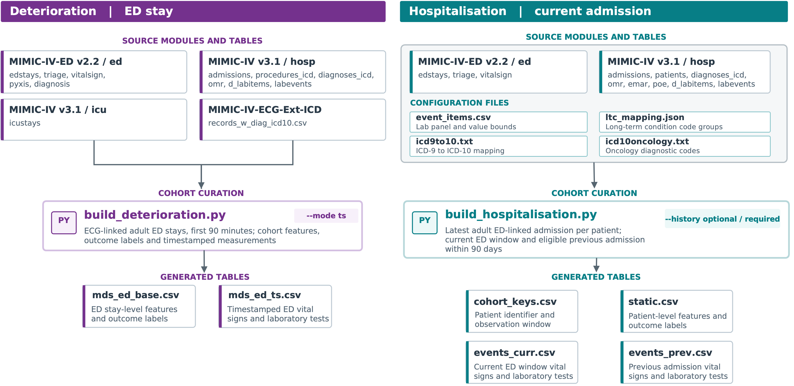
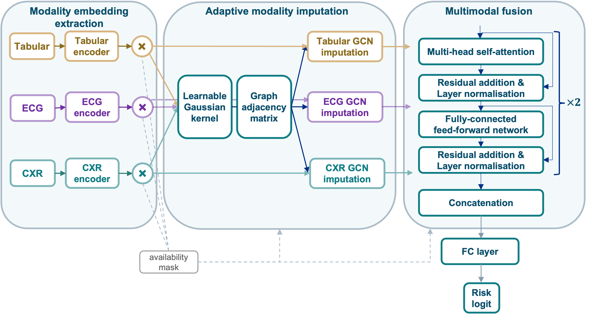
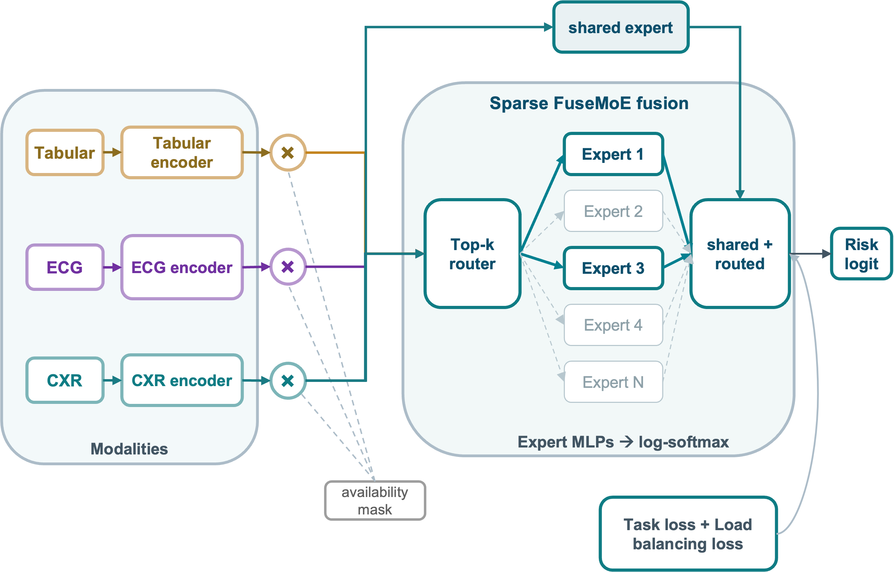

# Developer guide

This guide explains the pipeline and its extension points. For command arguments and file
formats, see the [API reference](api_reference.md).

## Data and cohorts

The deterioration pathway builds an ECG-linked ED cohort and uses the first 90 minutes of each stay.
The hospitalisation pathway uses the current ED window and, when available, a legacy window from a
previous admission discharged within the lookback window. See the
[deterioration](api_reference.md#deterioration-cohort) and
[hospitalisation](api_reference.md#hospitalisation-cohort) cohort sections for definitions and
source tables.

<figure markdown="1" style="margin: 1rem 0; padding: 0.5rem; background: #fff; color: #263238;">

<figcaption style="color: #263238;">Example source tables and cohort outputs. The deterioration builder does not apply an explicit adult-age filter. </figcaption>
</figure>

Preparation links the cohort to precomputed embeddings. Deterioration keeps one row per ED stay.
Hospitalisation keeps one current admission per patient. Missing modalities remain identifiable.
Hospitalisation notes come from a previous admission, so the current discharge summary cannot
leak the target outcome.

Deterioration splitting uses inherited folds. By default, it keeps the earliest validation and test
stay per patient. Complete-cohort splits use the matching all-cohort keys to select the same stays.
Hospitalisation creates a shared, stratified split for its outcomes. Reuse its split labels to
compare observation windows. In both pathways, preprocessing statistics are fitted on training
data and applied to validation and test data.

## Training pipeline

The main path is split parquet files → datasets and collators → modality encoders → fusion model
→ Lightning training → metrics and outputs. `data.task` selects the deterioration or
hospitalisation dataset. The selected outcome must be present in the split files.

Deterioration normally uses `tabular`, `ecg` and `cxr`. Temporal configurations can also use `ts`.
Hospitalisation can use `static`, `ts_prev`, `ts_curr`, `ecg_curr`, `cxr_prev`, `cxr_curr` and
`notes_prev`. The configured blocks must be present in the bundle. Features are accompanied by
missingness indicators and, for sequences, times and lengths. A missingness value of `1` means
missing.

Static encoders return one `(B, d_model)` representation per sample. Temporal encoders can return
sequences and their masks instead. Do not assume every fusion model uses the same number of
modalities or the same representation shape.

The training entry point supports one binary outcome per run. It drops rows with a missing target.
The model returns a logit and the Lightning wrapper applies binary cross-entropy. Model-specific
auxiliary loss is added during training, logged separately in validation and excluded from test
loss. Dataset-level multi-task masks do not imply multi-task training support.

## Fusion models

| Method | Main idea | Supplied task configurations |
|---|---|---|
| `concat` | Concatenate encoded modalities for prediction. | Deterioration and hospitalisation |
| `m3care` | Use patient-similarity graphs for optional missing-modality imputation, then fuse representations. | Deterioration and hospitalisation |
| Static FuseMoE `smp` | Route static representations through a static sparse MoE. | Deterioration and hospitalisation |
| Temporal FuseMoE `fusemoe` | Route temporal representations through experts inside a transformer encoder. | Deterioration |
| `mtand_m3care` | Combine mTAND temporal encoding with M3Care. | Deterioration |

The model factory supports these five names. Factory availability alone does not establish
compatibility with every task. The supplied temporal FuseMoE and mTAND-M3Care examples use raw time series
from an `all`-record deterioration bundle. The supplied hospitalisation models use their named
window-specific blocks. See [Getting started](getting_started.md#multimodal-learning) for
configurations.

### Concatenation

The concatenation model is the baseline. Each modality selected in `modality_names` is encoded to a
`d_model` vector, and these vectors are concatenated into a single input for the prediction head.
The head applies layer normalisation, two linear layers and dropout, and returns the logit. It does
not impute or route missing modalities, and it adds no auxiliary loss. Changes in performance
relative to this model show what imputation or routing contributes. See the
[concatenation settings](api_reference.md#concatenation-configuration).

### M3Care and contrastive learning

M3Care can construct patient-similarity graphs and use graph convolution to impute modality
representations. It then fuses the selected representations for prediction. Imputation,
missingness masking and loss settings are configurable.

<figure markdown="1" style="max-width: 600px; margin: 1rem auto; padding: 0.5rem; background: #fff; color: #263238;">

<figcaption style="color: #263238;">Example M3Care configuration with three modalities. Other configurations can use different modality blocks.</figcaption>
</figure>

**Contrastive learning** and **learned cross-modal targets** are optional. Observed-modality learning
aligns an imputed representation with its observed target. When a modality is missing, there is
no real representation to compare with, so the model builds one from the patient's other available
modalities and aligns the imputed representation with it. That target is the mean of the other
available modalities or, with `learned_cross_modal_target`, the output of a small network that reads
them and their availability masks. Learned-target supervision trains this network on observed
modalities, using a cosine or MSE reconstruction loss plus an InfoNCE term that keeps targets
specific to each patient.

A modality contributes to a contrastive objective only when the batch has at least
`min_contrastive_samples` eligible samples for it. Each objective is averaged over the modalities
that contributed, so a modality with no eligible samples does not dilute the mean, and weights are
applied after this averaging. The auxiliary loss is the graph-construction loss plus the weighted
contrastive and learned-target losses. The graph-construction loss is computed for every configured
modality, regardless of whether the modality is selected for GCN imputation, and summed or averaged with `mean_graph_construction_loss`. A weight of `0` keeps an objective's diagnostics but removes it from
optimisation. The extra projectors and target networks are built only when these objectives are
enabled, so baseline M3Care is unchanged.

An optional **two-stage workflow** first warms up on complete cases, then fine-tunes from that
checkpoint on naturally missing data. Complete-set filtering supports both deterioration
and hospitalisation. `config/m3care/m3care_deterioration_CL_warmup.yaml` trains the first stage with observed
contrastive learning and learned-target supervision.
`config/m3care/m3care_deterioration_CL_finetune.yaml` loads that checkpoint through `load_from` and
adds missing-modality contrastive learning. It turns off learned-target supervision, so the targets
learned during warm-up guide the missing-modality alignment without further training. When
`freeze_modality_encoders` is enabled, M3Care also freezes the target projector and learned-target
networks when present. The imputation and fusion pathways remain trainable unless separately
frozen. See the
[M3Care settings](api_reference.md#m3care-configuration) and
[M3Care run outputs](api_reference.md#run-logs-and-checkpoints).

### Static FuseMoE model

The static sparse MoE model routes static modality representations through experts.
A top-k router selects experts for each sample. An optional shared expert processes every sample,
and its prediction is mixed with the routed experts' predictions. Unavailable modalities are zeroed
before routing. The load-balancing loss is the model's auxiliary loss. Combination routing assigns
experts to modality combinations and is available only for this model. See the
[static FuseMoE settings](api_reference.md#static-fusemoe-model-configuration).

<figure markdown="1" style="max-width: 600px; margin: 1rem auto; padding: 0.5rem; background: #fff; color: #263238;">

<figcaption style="color: #263238;">Example static MoE configuration with three modalities and a shared expert.</figcaption>
</figure>

### Temporal FuseMoE

FuseMoE models ECG, CXR, and raw time series as sequences. **mTAND** places each
sequence on a shared grid of `mtand.tt_max` reference times, so `mtand.enabled` must be true and its
pooling must remain `none`. Each encoder layer applies self-attention within each modality, then
routes every modality's sequence positions through a shared pool of experts. The final position of
each sequence is joined with the static tabular representation and the sequence availability
indicators before the prediction head. Tabular features are not routed through experts.

Missing sequences are zeroed before routing. The load-balancing loss is summed across encoder
layers and used as the auxiliary loss. Routers can be `joint`, `permod` or `disjoint`. The
`ts_modality` mapping enables raw time series when the bundle contains them, which requires an
`all`-record deterioration bundle. Use `src.evaluation.output_expert` to inspect gate weights.
See the [FuseMoE settings](api_reference.md#fusemoe-configuration).

### mTAND-M3Care
    
mTAND-M3Care extends M3Care with mTAND time-aware encoding for ECG, CXR and optionally raw time series. The resulting embeddings are used for patient-similarity graph construction and optional GCN imputation, following the same principles as M3Care. Unlike standard M3Care, the graph-construction losses are always summed across configured modalities, and contrastive-learning and learned-target objectives are not implemented.

By default, only ECG, CXR and optionally time series representations participate in the two-stage attention fusion, while tabular features are concatenated with the fused representations before prediction. Fusion modalities must have equal embedding widths. See the [mTAND-M3Care settings](api_reference.md#mtand-m3care-configuration) for configuration options and input requirements.

## Evaluation, fairness and explainability

Modality ablation masks selected inputs at test time. Permutation shuffles modality content
within availability groups, helping distinguish information in the values from information in
availability. Scenario sets depend on the task and configured modalities.

For MoE models, [expert routing](api_reference.md#expert-routing) records the experts the router
selects for each sample and summarises expert use by modality. For models with mTAND encoders,
[mTAND attention](api_reference.md#mtand-attention) plots attention over observation times, showing
which measurement times the encoder relies on.

Fairness analysis compares group rates and ratios. It measures disparities. It does not apply a
mitigation. Bootstrap intervals describe uncertainty in the sampled predictions. Paired model
comparisons require aligned predictions for the same patients and split.

Tabular [SHAP](https://arxiv.org/abs/1705.07874) attributes a prediction to features.
[MM-SHAP](https://arxiv.org/abs/2212.08158) estimates modality contributions. Gradient and kernel
explainers have different costs and behaviour. Gradient attributions do not necessarily sum exactly
to the predicted probability. [Grad-CAM](https://arxiv.org/abs/1610.02391) rebuilds the image
feature graph to create a spatial overlay. The overlay is an attribution, not a segmentation or
diagnosis.

!!! note "Explaining M3Care with imputation"

    M3Care with imputation needs extra care. Its imputation links patients in the same batch
    through a similarity graph, so a patient's prediction also depends on the other patients in the
    batch. SHAP and Grad-CAM change one patient's inputs at a time. Scoring that patient alone, or
    in a different batch, would change its neighbours and explain a prediction the model never
    made. The explainers therefore save the graph and inputs from the patient's real test batch,
    then vary only that patient's inputs while the other patients and their connections stay fixed.
    Changes can still pass through neighbours and back, so cross-patient imputation stays active.
    Other models, and M3Care without imputation, score each patient separately.

Use the [API reference](api_reference.md#evaluation) for command inputs and outputs.

## Adding a new fusion model

Our training pipeline is modular. Datasets, collators, modality encoders, the Lightning wrapper and
the evaluation tools are shared across models. A new fusion model is added as a class that extends
`BaseMultimodalModel` in `src/models/base.py` and is then registered with the pipeline.

1. **Write the model.** Add a module under `src/models/`. Subclassing `BaseMultimodalModel` in
   `src/models/base.py` creates one encoder per modality and provides `encode`, so most models only
   implement `fuse` and `predict`. The model receives the batch dictionary and returns raw logits
   shaped `[batch]` or `[batch, 1]`. The Lightning wrapper applies the sigmoid and loss.
2. **Return auxiliary outputs if needed.** Set `supports_aux_output = True` and accept
   `return_aux` in `forward`. Then return a dictionary with `logits`, plus `aux_loss` and any
   extras such as `gate_weights`. The wrapper adds `aux_loss` to the training loss only and logs
   it as `train_aux_loss` and `val_aux_loss`.
3. **Add a builder.** Write a `build_<name>_model_from_config(fusion_cfg, feature_dims)` function
   next to the model. Feature widths are read from the first training batch, keyed by modality
   name.
4. **Register the method.** In `src/models/factory.py`, add the name to `ACTIVE_FUSION_METHODS`
   and a branch in `build_fusion_model`. Use `_configured_feature_dims` so `modality_names` is
   respected.
5. **Choose a batch format.** Set `model.collate_style` to an existing style in `COLLATE_FNS`
   (`src/data/collate.py`). The supplied configurations use `concat` for the concatenation model,
   `fusemoe` for the static and temporal FuseMoE, and `m3care` for M3Care and mTAND-M3Care. The
   three styles currently build the same batch, with padded features, times, lengths and
   missingness for every modality. The separate names are reserved for model-specific fields,
   and none have been added yet. Add a collator only if the model needs fields that this batch does
   not provide.
6. **Add a configuration.** Create `config/<name>.yaml` with `model.name`, `model.fusion_method`
   and `model.collate_style`. Add a deterioration configuration, a hospitalisation configuration,
   or both, and check the modality names and temporal requirements for each.
7. **Opt into evaluation tools.** Modality ablation and permutation work through the shared batch.
   To export expert gate weights, add the name to `EXPERT_METHODS` in
   `src/evaluation/output_expert.py`. To select the method explicitly in modality ablation, add it
   to the `--fusion-method` choices in `src/evaluation/modality_ablation.py`.
8. **Document it.** Add a row to the [fusion models](#fusion-models) table, a subsection on this
   page and a configuration section in the [API reference](api_reference.md#model-training).

