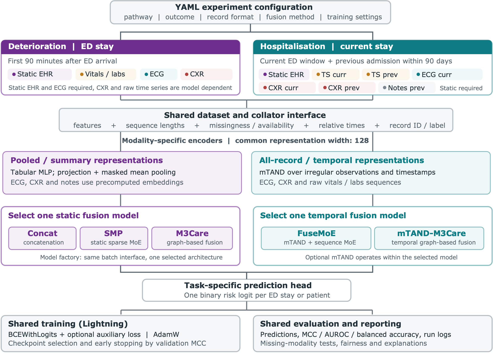

# mm-healthfusion

Clinical decisions draw on a record built from many sources: medical history, vital signs and
laboratory tests, ECGs, chest X-rays and clinical notes. Together, these sources give a fuller
picture of a patient's condition, but some are missing and measurements arrive at uneven times.
We built **mm-healthfusion** to combine these multi-modal records and study how well models predict
clinical outcomes when the available information varies. Our current retrospective evaluations use
the **[MIMIC-IV](https://physionet.org/content/mimiciv/3.1/)** dataset and linked datasets from one
US medical centre.

We build two pathways: predicting deterioration during an emergency department stay and
predicting hospitalisation outcomes from current ED records, optionally with notes from an eligible
previous admission. For each, we combine structured records and time-series measurements with ECG
and chest X-ray embeddings. A shared training and evaluation pipeline lets us compare a simple
concatenation baseline with sparse MoE models and graph-based imputation when
modalities are missing. For compatible models and tasks, we also study contrastive learning,
training first on complete records before fine-tuning with missing modalities, and methods that
account for irregular measurement times. We assess prediction performance, separate the signal in
recorded values from the signal in modality availability, and use explanations and subgroup
fairness analysis to understand model behaviour.

We build on [MM-HealthFair](https://github.com/nhsengland/mm-healthfair), extending its fairness and
explainability work with ECG and chest X-ray data. The deterioration pathway is adapted from the
[MDS-ED codebase](https://github.com/AI4HealthUOL/MDS-ED/tree/main) and its
[benchmark dataset](https://physionet.org/content/multimodal-emergency-benchmark/1.0.0/). These
experiments use data from one US medical centre, so their results need separate validation before
they can be applied to other hospitals or used to inform clinical decisions. Start with
[Getting started](getting_started.md) for data access, installation and the
workflow.

## Two care pathways

| Pathway | Information available | Evaluated outcomes |
|---|---|---|
| Deterioration | The first 90 minutes of an ED stay: tabular EHR features, vital signs, laboratory measurements, ECG and available chest X-rays | Mechanical ventilation, cardiac arrest, one-day mortality, ICU admission within 24 hours and ICU admission during the hospital stay |
| Hospitalisation | Current and legacy observation windows: static EHR features, vital signs, laboratory measurements, ECG, chest X-rays and previous-admission notes | Extended hospital stay over seven days, in-hospital death and non-home discharge |

## Multi-modal pipeline

We start by choosing a pathway, outcome, record format, fusion method and training settings. For
each pathway, we prepare a cohort that combines structured records and vitals and lab measurements
with ECG and chest X-ray embeddings. Hospitalisation can also use notes from an eligible previous
admission. We split each cohort into training, validation and test data, keeping track of available
modalities and, for temporal models, sequence lengths and measurement times. Modality-specific
encoders produce static or temporal representations, which a compatible fusion model uses to make
one binary prediction per ED stay or patient. We then report predictions and performance metrics,
and examine missing-modality behaviour, feature explanations and fairness across patient groups.

<figure style="margin: 1rem 0; padding: 0.5rem; background: #fff; color: #263238;">
  
  <figcaption style="color: #263238;">Configuration selects the task and compatible model. The shared training and evaluation steps produce outcome predictions, performance metrics, missing-modality tests, fairness results and explanations.</figcaption>
</figure>

## Next steps

Follow the [deterioration](examples/deterioration.md) and
[hospitalisation](examples/hospitalisation.md) examples for task workflows, and the
[analysis example](examples/analysis.md) for evaluation and explainability. The
[synthetic data example](examples/synthetic.md) works without MIMIC access. Its demo notebook runs
the full workflow, from the data formats to training, evaluation, explanation and fairness
evaluation of the static FuseMoE model, and the example gives the commands for every static fusion
model. See
[Cohort tables](create_tableone.md) to summarise baseline characteristics. The
[API reference](api_reference.md) covers commands and configuration, the
[developer guide](developer_guide.md) explains the pipeline and how to extend it, and
[citations](citations.md) lists the datasets and methods used in the project.
